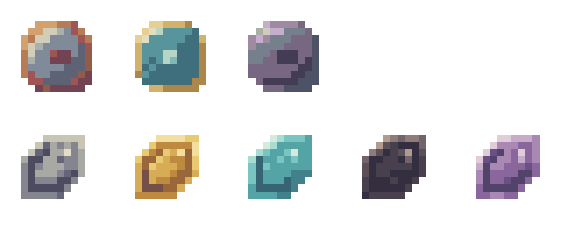

# RabbitTools

适合生存建造、采矿和短距移动的工具集。

**Minecraft 1.21.1 · NeoForge 21.1.265+（21.1.x） · Java 21**

[发布页](https://github.com/RabbitWorldTeam/RabbitTools/releases) · [Wiki 指南](https://github.com/RabbitWorldTeam/RabbitTools/wiki) · [问题反馈](https://github.com/RabbitWorldTeam/RabbitTools/issues)

## 主要功能

| 工具 | 用途 |
| --- | --- |
| 建筑手杖 | 批量铺方块，支持预览、撤销和功能核心 |
| 采矿锤 | 开采 3×3 平面，潜行切换单格 |
| 传送手杖 | 潜行右键短距穿墙，落到安全地面 |
| 砌筑铲 | 从快捷栏随机取材，逐格混铺 |
| 测量尺 | 两点测量尺寸、净空和几何中心 |
| 上色刷 | 潜行右键打开 16 色调色盘 |
| 虚空袋 | 自动收纳拾取物，可连接容器 |

## 安装

将 `rabbittools-1.21.1-neoforge-1.0.0.jar` 放入客户端和服务端的 `mods/`。RabbitTools 可独立安装。

## 常用入口

- `/rabbittools travelstaff status` · 查询传送手杖状态，使用 `enable` 或 `disable` 切换。
- `config/rabbittools-server.toml` · 建造手杖和核心限制。
- `config/rabbittools-client.toml` · 本地显示与操作偏好。

## 从源码构建

`./gradlew build`，Windows 使用 `.\gradlew.bat build`。JAR 输出到 `build/libs/`。

[验证记录](docs/VERIFICATION.md) · [美术规范](docs/ART_STYLE.md) · [第三方声明](THIRD_PARTY_NOTICES.md) · [MIT](LICENSE)
